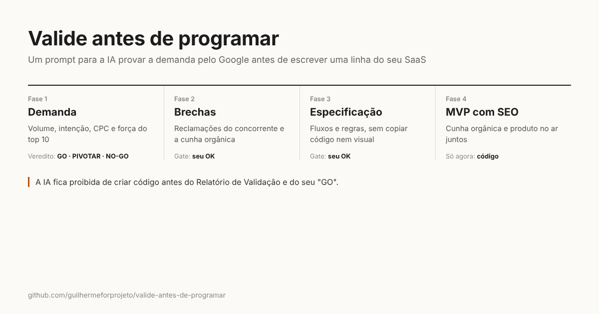
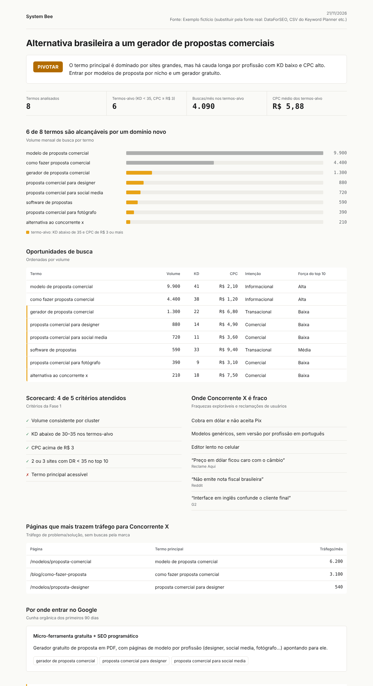

# Validate before you code

**A master prompt that makes Claude, ChatGPT or Cursor prove there's search demand on Google before writing a single line of your SaaS. No "GO" from you, no code.**

[🇧🇷 Português](README.md) | 🇺🇸 English

Telling an AI "build a SaaS like X" is easy, and it will happily start coding. The hard part is knowing, beforehand, whether anyone will find that product. This prompt locks the AI into a 4-phase pipeline: first it shows search volume, CPC, difficulty and the competitor's weak spots in a dashboard published to your browser; only after your "GO" does it spec and build.



---

## The 4 phases

| Phase | What the AI does | Gate |
|---|---|---|
| **1. Demand** | Splits the competitor's branded vs problem traffic, filters commercial terms, checks CPC and analyzes the Google top 10 | Verdict **GO / PIVOT / NO-GO** |
| **2. Gaps** | Mines competitor complaints (G2, Capterra, Reddit…) and defines the organic wedge: free micro-tool, comparison pages or programmatic SEO | Your OK |
| **3. Spec** | Maps flows and rules with a trial account and writes `PRD.md`, `DATA_MODEL.md` and `SEO_ARCHITECTURE.md`, without copying code, copy or visuals | Your OK |
| **4. SEO-driven MVP** | Builds the organic wedge alongside the product: SSR/SSG, sitemap, JSON-LD, Core Web Vitals | Only now: code |

### The Phase 1 scorecard

- 🟢 **GO:** 200–500+ searches/month per cluster, KD < 30–35, CPC above US$1 and 2 or 3 weak sites (DR < 35) in the top 10.
- 🟡 **PIVOT:** head term owned by giants, but long-tail or sub-niche openings exist.
- 🔴 **NO-GO:** low volume or a locked top 10. Better to quit early than after 3 months of coding.

## How to use it

1. Copy **[`prompts/en.md`](prompts/en.md)** into your Claude/ChatGPT project instructions, `CLAUDE.md` or `.cursor/rules/`.
2. Give the AI real data. Ideally an SEO MCP (DataForSEO, SE Ranking, Ahrefs, Semrush), but CSV exports from **Google Keyword Planner** or **Search Console** work too. Without data, the AI is told to warn you and mark everything as an estimate.
3. Ask: *"I want to build an alternative to [competitor]"*. The AI starts at Phase 1 and delivers the report.
4. Use **[`templates/RELATORIO-VALIDACAO.md`](templates/RELATORIO-VALIDACAO.md)** (Portuguese) to store or fill in the report by hand.

## Report dashboard online

When the report is done, the AI writes the data to `viewer/dados.json`, starts a local server and publishes the dashboard through a temporary Cloudflare tunnel. The link is only handed over after **5 checks**:

1. **Local service** answering on `localhost:4173/health`
2. **`cloudflared` tunnel** connected and the `*.trycloudflare.com` URL captured
3. **DNS propagated** (checked on `1.1.1.1` and `8.8.8.8`, with retries)
4. **TLS on port 443** with a valid certificate
5. **End-to-end health check** via the public URL, no 502/503



To run it by hand (Node.js 18+ and [`cloudflared`](https://developers.cloudflare.com/cloudflare-one/connections/connect-networks/downloads/)):

```bash
node viewer/server.mjs      # local only: http://localhost:4173
node viewer/publicar.mjs    # local + public link, with the 5 checks
```

**Visual identity:** colors, fonts, logo and border radius live in [`viewer/brand.json`](viewer/brand.json). The default theme is System Bee's; swap in your own brand values.

> ⚠️ The `trycloudflare.com` link is public: anyone with it can see the dashboard. It's temporary and disappears when you stop the process. Don't put sensitive data in the report.

## Built-in ethical limits

- Reverse engineering of **behavior** only (flows, rules, information architecture), with a trial account and within the competitor's Terms of Service.
- No copying source code, logos, illustrations, copy or visual identity.
- Comparison pages with accurate, up-to-date information about the competitor.
- Programmatic SEO with genuinely useful content, not cloned pages with one word swapped.

## Contributing

Have a better scorecard threshold, a free data source or a real (anonymized) report example? Open an issue or a pull request.

If this helped, a ⭐ helps others find it.

## More prompts

[dashboard-sem-cara-de-ia](https://github.com/guilhermeforprojeto/dashboard-sem-cara-de-ia) · [seguranca-antes-de-lancar](https://github.com/guilhermeforprojeto/seguranca-antes-de-lancar) · [web-moderna-para-ia](https://github.com/guilhermeforprojeto/web-moderna-para-ia)

## License

[CC BY 4.0](LICENSE): use, copy, adapt and redistribute freely, commercially too. Just credit the source with a link to this repo.
