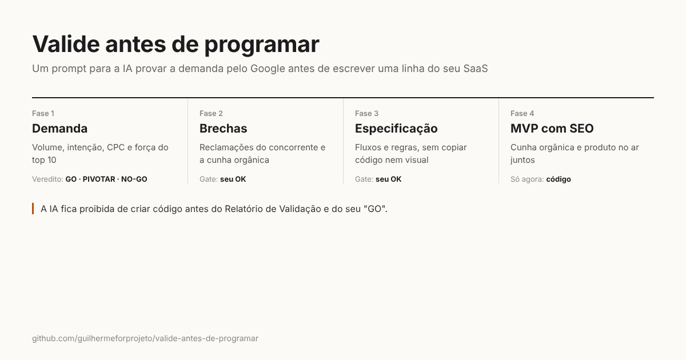
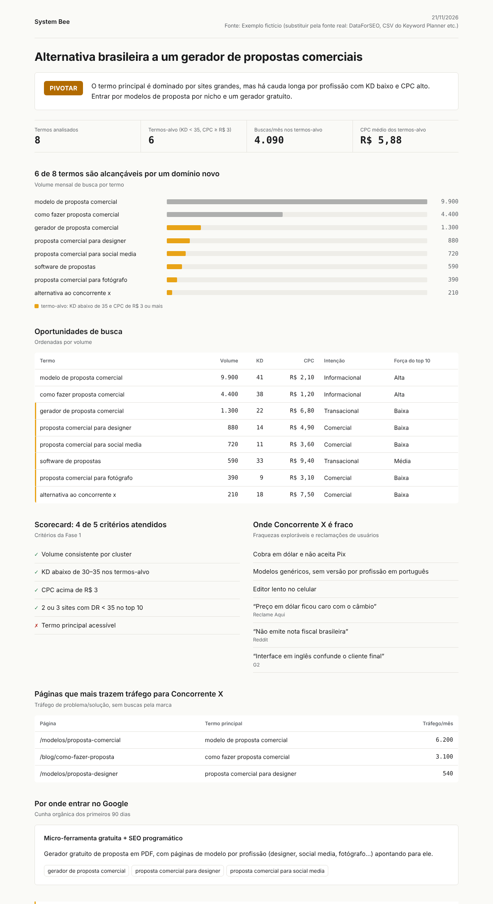

# Valide antes de programar

**Um prompt-mestre para o Claude, ChatGPT ou Cursor provarem que existe demanda pelo Google antes de escrever uma linha do seu SaaS. Sem "GO" seu, sem código.**

🇧🇷 Português | [🇺🇸 English](README.en.md)

Pedir "cria um SaaS igual ao X" para uma IA é fácil, e ela vai obedecer na hora. O difícil é descobrir, antes, se alguém vai achar esse produto. Este prompt trava a IA num pipeline de 4 fases: primeiro ela mostra volume de busca, CPC, dificuldade e as brechas do concorrente, num painel publicado no navegador; só com o seu "GO" ela especifica e programa.



---

## As 4 fases

| Fase | O que a IA faz | Gate |
|---|---|---|
| **1. Demanda** | Separa tráfego de marca do tráfego de problema do concorrente, filtra termos comerciais, checa CPC e analisa o top 10 do Google | Veredito **GO / PIVOTAR / NO-GO** |
| **2. Brechas** | Lê reclamações do concorrente (Reclame Aqui, G2, Reddit…) e define a cunha orgânica: micro-ferramenta grátis, páginas de comparação ou SEO programático | Seu OK |
| **3. Especificação** | Mapeia fluxos e regras com conta de teste e gera `PRD.md`, `DATA_MODEL.md` e `SEO_ARCHITECTURE.md`, sem copiar código, textos ou visual | Seu OK |
| **4. MVP com SEO** | Constrói a cunha orgânica junto com o produto: SSR/SSG, sitemap, JSON-LD, Core Web Vitals | Só agora: código |

### O scorecard da Fase 1

- 🟢 **GO:** 200 a 500+ buscas/mês por cluster, KD < 30–35, CPC acima de R$ 3 (US$ 1) e 2 ou 3 sites fracos (DR < 35) no top 10.
- 🟡 **PIVOTAR:** termo principal dominado por gigantes, mas com cauda longa ou subnicho aberto.
- 🔴 **NO-GO:** pouco volume ou top 10 blindado. Melhor desistir cedo do que depois de 3 meses programando.

## Como usar

1. Copie **[`prompts/pt-BR.md`](prompts/pt-BR.md)** (ou [`prompts/en.md`](prompts/en.md)) para as instruções do projeto no Claude, no ChatGPT, no `CLAUDE.md` ou em `.cursor/rules/`.
2. Dê dados reais para a IA. O ideal é um MCP de SEO (DataForSEO, SE Ranking, Ahrefs, Semrush), mas funciona com CSVs exportados do **Google Keyword Planner** ou do **Search Console**. Sem dados, a IA é instruída a avisar e marcar tudo como estimativa.
3. Peça: *"Quero criar uma alternativa ao [concorrente]"*. A IA começa pela Fase 1 e entrega o relatório.
4. Use o **[`templates/RELATORIO-VALIDACAO.md`](templates/RELATORIO-VALIDACAO.md)** para guardar ou preencher o relatório na mão.

## Painel do relatório no ar

Ao terminar o relatório, a IA grava os dados em `viewer/dados.json`, sobe um servidor local e publica o painel com um túnel temporário da Cloudflare. O link só é entregue depois de **5 verificações**:

1. **Serviço local** respondendo em `localhost:4173/health`
2. **Túnel `cloudflared`** conectado e URL `*.trycloudflare.com` capturada
3. **DNS propagado** (checado em `1.1.1.1` e `8.8.8.8`, com novas tentativas)
4. **TLS na porta 443** com certificado válido
5. **Health check ponta a ponta** pela URL pública, sem 502/503



Para rodar na mão (Node.js 18+ e [`cloudflared`](https://developers.cloudflare.com/cloudflare-one/connections/connect-networks/downloads/)):

```bash
node viewer/server.mjs      # só local: http://localhost:4173
node viewer/publicar.mjs    # local + link público, com as 5 verificações
```

No Windows, o `cloudflared` instala com `winget install --id Cloudflare.cloudflared`.

**Identidade visual:** cores, fontes, logo e raio de borda ficam em [`viewer/brand.json`](viewer/brand.json). O tema padrão é o da System Bee; troque pelos valores da sua marca.

> ⚠️ O link `trycloudflare.com` é público: qualquer pessoa com ele vê o painel. Ele é temporário e some quando você encerra o processo. Não coloque dados sensíveis no relatório.

## Limites éticos já embutidos

- Engenharia reversa só de **comportamento** (fluxos, regras, arquitetura de informação), com conta de teste e respeitando os Termos de Uso do concorrente.
- Proibido copiar código-fonte, logos, ilustrações, textos ou identidade visual.
- Páginas de comparação com informação verdadeira e atualizada sobre o concorrente.
- SEO programático com conteúdo útil de verdade, não páginas clonadas trocando só uma palavra.

## Contribua

Tem um critério melhor para o scorecard, uma fonte de dados gratuita ou um exemplo de relatório real (anonimizado)? Abra uma *issue* ou um *pull request*.

Se isso te ajudou, deixa uma ⭐. Ajuda mais gente a achar.

## Mais prompts

[dashboard-sem-cara-de-ia](https://github.com/guilhermeforprojeto/dashboard-sem-cara-de-ia) · [seguranca-antes-de-lancar](https://github.com/guilhermeforprojeto/seguranca-antes-de-lancar) · [web-moderna-para-ia](https://github.com/guilhermeforprojeto/web-moderna-para-ia)

Validou e vai lançar? Rode o [seguranca-antes-de-lancar](https://github.com/guilhermeforprojeto/seguranca-antes-de-lancar) antes do deploy.

## Licença

[CC BY 4.0](LICENSE): use, copie, adapte e redistribua à vontade, inclusive comercialmente. Só cite a fonte, com um link para este repositório.
